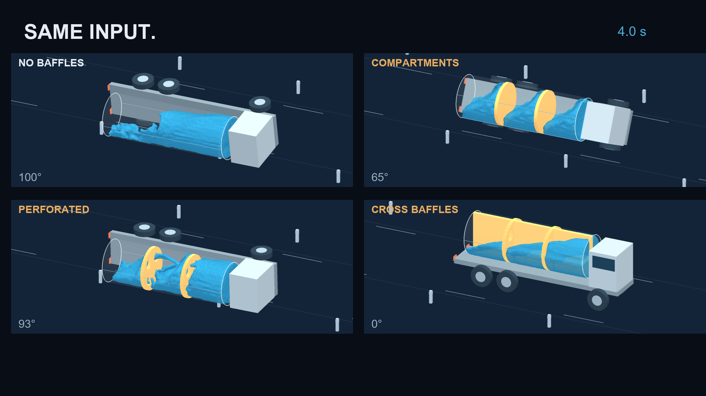
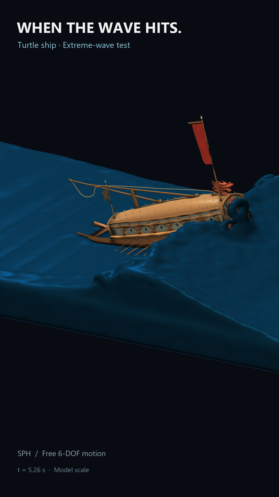

# Free-surface examples: ships in waves and tanker sloshing

**New: tanker braking, sloshing and rollover.** Four matched-mass layouts with native two-way SPH/Chrono coupling. [Case 06](SPH_CFD-incomp-free-surface-6DOF_GPU_Cpp-CUDA-Python_06-tanker-sloshing) · [Portrait, 36.5 s](media/tanker_sloshing_final_portrait.mp4) · [Landscape, 36 s](media/tanker_sloshing_final_landscape.mp4) · [Reproduce](docs/TANKER_REPRODUCE.md).

[Next industrial examples](docs/NEXT_INDUSTRIAL_EXAMPLES.md): battery propagation, drone wakes, underfill, lubrication and marine flooding. Research proposals, not completed simulations.

<a href="media/tanker_sloshing_final_landscape.mp4"></a>

**Can we predict a turtle ship's motion in waves?** A compact demonstration using Capytaine and DualSPHysics, with a computed bow-impact intro and a 35-second portrait film.

**New: Gunnerus in focused head waves.** A completed 16 s, 9.99-million-particle GPU example with free six-DOF motion and assumed thrust. [Case and results](SPH_CFD-incomp-free-surface-6DOF_GPU_Cpp-CUDA-Python_05-gunnerus-focused-wave) · [Portrait film](media/gunnerus_stronger_waves_methods_portrait.mp4) · [Landscape film](media/gunnerus_stronger_waves_methods_landscape.mp4) · [Model, scaling and resolution notes](docs/MARINE_MODEL_NOTES.md).

[Watch / download the final film](media/turtle_ship_story_v7_focused_portrait.mp4) · [3-second impact intro](media/turtle_focused_intro.mp4) · [Video description and model credit](media/turtle_ship_story_v7_focused_portrait_description.txt)

<a href="media/turtle_ship_story_v7_focused_portrait.mp4"></a>

## Included cases

| Case | Method / hardware | Conditions | Recorded computation |
|---|---|---|---|
| [01 Potential](BEM_CFD-incomp-free-surface-6DOF_CPU_Python_01-potential) | Linear potential-flow BEM / Ryzen 9 9950X | Mean wetted hull, six harmonic DOFs, reference speed 0.5 m/s | 6,165 panels; 153.85 s response, 213.79 s including surface evaluation |
| [02 Coasting](SPH_CFD-incomp-free-surface-6DOF_GPU_Cpp-CUDA-Python_02-coasting) | DualSPHysics / RTX 5080 | Initial +x speed 0.5 m/s, then fully free 6-DOF; opposing regular waves | 943,816 particles; 16.0 model s in 688.30 s |
| [03 Focused wave](SPH_CFD-incomp-free-surface-6DOF_GPU_Cpp-CUDA-Python_03-focused-wave) | DualSPHysics / RTX 5080 | Initially at rest; focused wave group; free 6-DOF | 2,885,421 particles; 10.0 model s in 1,552.27 s |
| [04 Empty flume](SPH_CFD-incomp-free-surface_GPU_Cpp-CUDA-Python_04-empty-flume) | 2-D SPH commissioning / GPU | Focused-wave generation without the ship | 12.0 model s; zero excluded particles |
| [05 Gunnerus](SPH_CFD-incomp-free-surface-6DOF_GPU_Cpp-CUDA-Python_05-gunnerus-focused-wave) | DualSPHysics / RTX 5080 | Focused waves, sealed hull/deckhouse, free 6-DOF, assumed 30 N CG force | 9,985,001 particles; 16.0 model s in 10,292 s; separate 2-D wave check |
| [06 Tanker](SPH_CFD-incomp-free-surface-6DOF_GPU_Cpp-CUDA-Python_06-tanker-sloshing) | DualSPHysics + Chrono / RTX 5080 | Four layouts; 0.40g brake + 0.69g lateral support-frame input; rigid vehicle/contact | 137,812 fluid particles per case; four 8 s runs in 703–728 s each |

The turtle SPH cases use 40 mm initial particle spacing, **1:10 scale**, 154.4 kg rigid-body mass and no propulsion. Gunnerus uses 50 mm spacing, 1:10 scale, an assumed/derived 398.9 kg loading condition and a world-fixed external CG force; it has no actuator disk or propeller wake. Coordinates, times, wave parameters and motion histories are model-scale unless explicitly marked otherwise.

Folder names follow `method_physics_resource_language_case`. `CFD-incomp` describes the intended water-flow problem; DualSPHysics uses **weakly compressible SPH** to approximate it. The GPU solver is upstream C++/CUDA; case generation, analysis and rendering are Python. This project does not use VOF, IBM, air-flow simulation, CHT or phase change.

## What is public

- Case definitions, piston input signals, physical assumptions and compact motion/audit results.
- Python geometry preparation, BEM calculation, SPH launch, analysis and film-rendering scripts in [study](study).
- Gunnerus setup, launch and postprocessing in [gunnerus](gunnerus), with [reproduction instructions](docs/GUNNERUS_REPRODUCE.md). Its selected MIT-derived contact meshes and notice are included; the original visual GLB is obtained separately.
- Tanker procedural geometry, setup, native coupling, grouped loads and final film workflow in [tanker](tanker), with [model notes](docs/TANKER_MODEL_NOTES.md). No external tanker CAD is required. Its Chrono-enabled build is distinct from the older ship build.
- Final MP4s, two rendered stills, source credits and [modification history](CHANGELOG.md).
- [Reproduction instructions](docs/REPRODUCE.md) and [agent handoff](docs/AGENT_HANDOFF.md).

Raw particle fields, generated boundary-particle datasets, render caches, environments and solver binaries are excluded. **The turtle source model and every derived geometry file are also excluded:** the creator allows rendered use but prohibits redistribution of the model files. Obtain your own copy from the [creator's page](https://wifewell.tistory.com/entry/거북선-3D파일FBXOBJ-및-블렌더-무료-나눔). A fresh clone can prepare the empty-flume case without that asset; reproducing the turtle calculations and rendering requires it and a local solver installation.

No numerical solver kernels were changed for the Gunnerus example. The new material is the case setup, geometry/loading assumptions, orchestration and visualization. **Setup files alone are enough only when the matching geometry, external solver and workflow are already available.** This package also preserves those workflow scripts, dependency/source references and compact results; it does not duplicate DualSPHysics binaries or full particle fields.

## Reading the results

Potential flow and SPH are **independent calculations**, not a coupled method or a controlled speedup benchmark. The BEM movie is a fixed-reference-speed harmonic response. SPH solves a free-coasting initial-value problem. The intro is another SPH condition: an initially stationary ship in a wider tank with a focused wave group.

The intro shows bow impact and strong motion. Whole-roof green water was **not** demonstrated: the central-roof probe remained empty, although the forward upper-hull probe detected some water. This is a visualization demonstration, not a validated peak-pressure, resistance or survivability prediction. The model omits air entrapment, flooding, damage and forces on decorative appendages. See [limits and numerical observations](docs/RESULTS.md).

## Start here

Windows / Python 3.13 was the reference environment. Install Python requirements in an isolated environment, then prepare a no-asset wave case:

```powershell
python -m pip install -r requirements.txt
python study/prepare_focused_turtle.py --name focus_empty_A065_near_40 --empty-2d --amplitude 0.65 --dp 0.04 --duration 12 --focus-x 1 --focus-time 7.5 --peak-period 2.2 --piston-x 6
```

That command only generates inputs. See [REPRODUCE.md](docs/REPRODUCE.md) for the solver, geometry, GPU run and rendering steps. Public case folders preserve the accepted reference snapshots; new calculations write under ignored `study/sph/` and `study/results/` paths.

## Sources and license

Repository scripts and configurations are GPL-3.0-or-later; see [LICENSE](LICENSE). Upstream software and rendered third-party artwork retain their own terms; the code license does not relicense those assets. [THIRD_PARTY_NOTICES.md](THIRD_PARTY_NOTICES.md) lists sources, pinned solver revision and model credit. Numerical inputs use historical sources as stated assumptions; the artistic hull is not official historical CAD.
