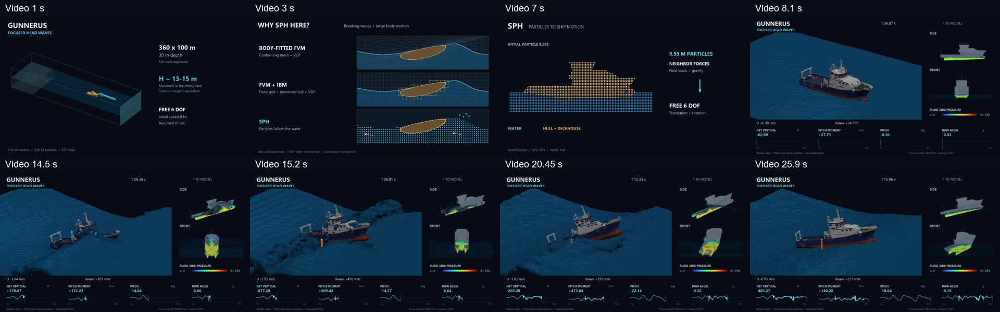

# Gunnerus: focused waves and free six-DOF motion

[Portrait, 1080×1920](../media/gunnerus_stronger_waves_methods_portrait.mp4) · [Landscape, 1920×1080](../media/gunnerus_stronger_waves_methods_landscape.mp4) · [Reproduce](../docs/GUNNERUS_REPRODUCE.md) · [Physics notes](../docs/MARINE_MODEL_NOTES.md)

Both 26-second films present domain setup → conceptual FVM/IBM/SPH comparison → actual SPH particle slice → computed motion with pressure views and synchronized loads. The last 18 video seconds replay model time 4–16 s; the comparison diagrams are not additional CFD calculations.

## Recorded problem and completion

| Item | Recorded condition |
|---|---|
| Case | `gunnerus_focus_A115_x5.5_D300_050_16s` |
| Solver / hardware | Upstream DualSPHysics 5.4.355, RTX 5080 |
| Scale / tank | 1:10; 36×10 m model footprint, 3 m water depth, free-surface z=0; 360×100×30 m full equivalent |
| Water / contact | WCSPH water only, sealed simplified hull/deckhouses, mDBC hull with missing-normal DBC fallbacks |
| Body | 398.8999 kg, assumed CG/inertia, all six DOFs free |
| Initial speed / force | +x 1.30145 m/s, 8 kn equivalent; assumed world-fixed +x 30 N at CG, ramp 0.3–1.3 s |
| Incident wave | Crest-focused first-order piston; target linear crest 1.15 m, component peak period 2.6 s, 0.24–0.85 Hz |
| Wave check | Independent 2-D empty flume; measured H=1.3641–1.4729 m at x=12/14 m, approximately 13.6–14.7 m full equivalent; not Hs |
| Spacing / particles | Uniform dp=0.05 m; 9,985,001 total, 8,581,760 fluid |
| Run | 16.00005 model seconds, approximately 72,750 native steps, 10,292 wall seconds (2 h 52 min) |
| Recorded checks | Zero particle losses and dt-min clamps; sampled fields finite; no capsize in completed interval |

`setup/` preserves solver XML, the piston signal and physical inputs. `geometry/` contains the small MIT-derived reference contact surfaces and notice, not the original visual GLB. `empty_flume/` preserves the independent commissioning inputs, checks and two recorded gauges. `results/` contains compact diagnostics only. `@GUNNERUS_ROOT@` is a relocatable placeholder expanded by the stager; do not pass unresolved XML directly to GenCase.

## Selected replay metrics, model time 4–16 s

| Metric | Recorded range |
|---|---|
| Heave | −0.355 to +0.553 m |
| Pitch, bow-down positive | −22.43 to +16.75° |
| Net vertical force | −1,987.6 to +1,115.5 N |
| Body pitch moment about CG | −1,127.7 to +1,967.8 N·m |
| Foredeck vertical kinematic acceleration | −1.211 to +0.687 g |

Definitions and timestamps are in [motion_and_loads.csv](results/motion_and_loads.csv) and [clip metrics](results/gunnerus_stronger_clip_metrics.json). The CSV includes the full 0–16 s monitor history, so full-run extrema can differ from the displayed 4–16 s interval. The pitch moment is a rigid-body fluid moment, not structural bending; foredeck acceleration is not accelerometer specific force.

## Interpretation limits

This is a visualization and workflow demonstration. The approximate visual hull is not production CAD; mass/CG/inertia are not the real vessel's measured loading. The force is not a resolved propeller or actuator disk, and does not hold speed. VRes and RANS-map coupling were discussed but not implemented.

There is no formal resolution/time-step convergence study. The draft spans only 5.4 particle intervals. Sampled density ranged approximately 910–1,144 kg/m³; successful completion alone does not validate pressure or loads. The native generator warned of missing boundary normals: fixed/piston DBC fallbacks and 1,239 floating samples without normals. Keep these observations when assessing accuracy.

Pressure colors are nearby-water gauge pressure sampled half a spacing outside the contact faces, with insufficient support gray. The fixed −4 to +8 kPa color scale saturates outliers; recorded supported samples span approximately −15.9 to +22.0 kPa. At 0.1 s field output intervals, these are not resolved slam peaks or wall tractions. Fine films, spray, drainage ports, air entrapment, flooding and structural failure are absent.

No full particle fields, restart files, generated boundary-particle coordinates, render caches, solver binaries or environments are published. Accepted video hashes and a full allowlist are in [MANIFEST.json](MANIFEST.json).
