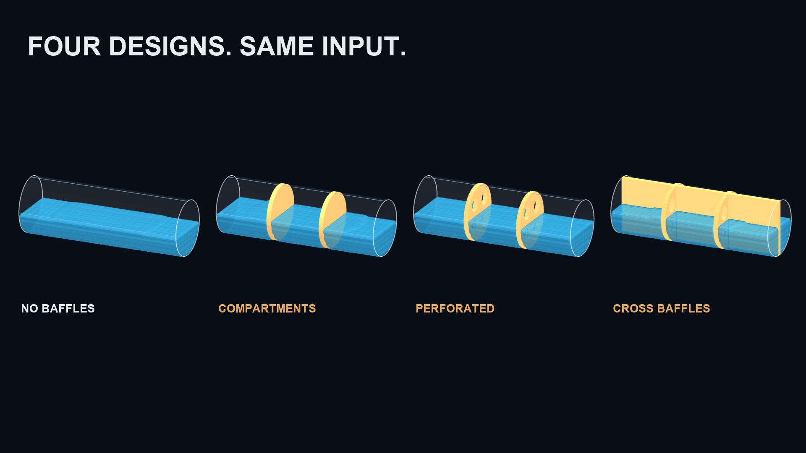

# Tanker sloshing: four designs, one input

Water shifts during braking and lateral acceleration. The resulting fluid forces feed back into a freely moving rigid truck through native SPH/Chrono coupling. This example compares no baffles, liquid-tight transverse compartments, perforated transverse baffles, and perforated transverse plus a longitudinal baffle.

[Portrait, 36.5 s](../media/tanker_sloshing_final_portrait.mp4) · [Landscape, 36 s](../media/tanker_sloshing_final_landscape.mp4) · [Reproduce](../docs/TANKER_REPRODUCE.md) · [Model notes](../docs/TANKER_MODEL_NOTES.md)

| Layout | First side lift | First 75° tilt | Peak fluid roll moment* | Rollover within 8 s |
|---|---:|---:|---:|---|
| No baffles | 2.35 s | 3.85 s | 60.0 kNm | Yes |
| Compartments | 2.65 s | 4.10 s | 60.7 kNm | Yes |
| Perforated | 2.40 s | 3.90 s | 55.7 kNm | Yes |
| Cross baffles | None | None | 40.3 kNm | No |

*Common 1.5–3.5 s window, cubic Savitzky–Golay filtering across nine saved 0.05 s states. Moment is about the instantaneous dry-vehicle CG, body x axis. Cross baffles reduced this peak by 32.9% relative to no baffles. This is a conditional result for a generic rigid vehicle at one spatial resolution, not a road-vehicle safety rating. A sustained 75° tilt defines the recorded rollover onset; some rigid cases can roll through and return upright because damage is absent.

All four simulations completed 8 physical seconds with zero excluded particles. Boundary-integrity checks passed; sealed compartments and the longitudinal partition had no observed particle-ID crossings at saved states. The four runs took 703–728 s each on an RTX 5080, about 47.7 min total. Each uses 137,812 fluid particles at 40 mm spacing. Native whole-body fluid loads and independently recomputed sums agree within approximately 1.1% filtered NRMSE.

The common tank is 6 m long and 2 m in diameter, with 8,819.968 kg water and a 9,000 kg dry rigid vehicle. Input peaks are 0.40g braking and 0.69g lateral acceleration. The displayed road cue starts at 50 km/h. Numerical baffle envelopes are 160 mm thick; they are not sheet-metal thickness predictions. Dry mass and inertia are held equal across layouts.

`cases/` holds compact reference inputs and results. `Case_Def.reference.xml` contains explicit particle-path placeholders: use the procedural generator, not those templates directly. No downloaded truck/tank CAD is required. Full fields, generated particle positions, render caches and external binaries are deliberately excluded. Replay of fluid motion requires regenerating the calculation; CSV histories alone cannot reconstruct it.

The final films show actual computed motion. Their opening compresses the entire 8 s record into 4 s; method equations appear for 2.5 s. Jet contours show N per boundary particle, not pressure; the common log scale spans 0–5,000 N. Cyan/orange numbers and arrows represent total fluid-force and total fluid-moment magnitudes/directions. White arrows indicate individual baffle resultants.

No numerical governing equation or solver kernel was changed. The additions are procedural geometry, input/loading, a Chrono-enabled build recipe, guarded launch/analysis, load extraction and visualization. See the repository source/license notices.
